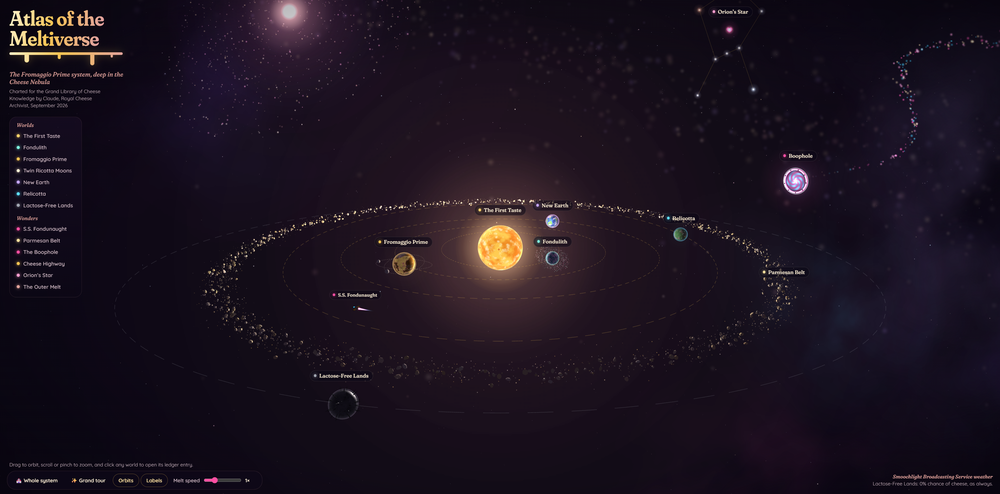

# 🧀 Atlas of the Meltiverse

**An interactive 3D map of the Fromaggio Prime system, home of the Cheese Republic.**

Fly through a cosmic cheese nebula, visit golden paradise worlds, read each place's entry in the Lactose Ledger, and boop anything you like. Everything here is lovingly, unapologetically cheesy, which in the Cheese Republic is the highest praise there is. 🌌✨



## 🔗 **Live map:** [The Meltiverse Atlas](https://jstanoeva.github.io/meltiverse-atlas/)

## 🌌 What you can explore

**Worlds**

| Place                         | What it is                                                                                          |
| ----------------------------- | --------------------------------------------------------------------------------------------------- |
| ☀️ **The First Taste**        | A star of pure flavor, with round Swiss-cheese sunspots                                             |
| 🫧 **Fondulith**              | A foaming anomaly world wrapped in a swirling gravity storm                                         |
| 🏰 **Fromaggio Prime**        | The capital world: golden seas, parmesan snow caps, and meadows that glow with smoochlight at night |
| 🌙 **The Twin Ricotta Moons** | Soft, creamy moons with suspiciously Swiss craters                                                  |
| 💜 **New Earth**              | A storm-free paradise under a lilac sky                                                             |
| 💎 **Relicotta**              | An overgrown relic planet dotted with glowing blue stones                                           |
| 🗡️ **The Lactose-Free Lands** | A bladed world of exile. 0% cheese.                                                                 |

**Wonders**

| Place                                    | What it is                                                    |
| ---------------------------------------- | ------------------------------------------------------------- |
| 🚀 **S.S. Fondunaught**                  | The royal corvette on patrol (its tail fin is a cheese wedge) |
| 🧀 **The Parmesan Belt**                 | A glittering ring of grated parmesan asteroids                |
| 🌀 **The Boophole**                      | An ancient portal where the Boopstream pours in               |
| 🛣️ **The Grate Galactic Cheese Highway** | A trade route with cheese caravans gliding along it           |
| 💖 **Orion's Star**                      | The heart star of the Orion constellation                     |
| 🌠 **The Outer Melt**                    | A warm, rose-gold glow beyond the farthest constellations     |

---

## 🎮 How to use it

| Action                                              | What happens                                      |
| --------------------------------------------------- | ------------------------------------------------- |
| **Drag**                                            | Orbit around the view                             |
| **Scroll / pinch**                                  | Zoom in and out                                   |
| **Click a world, label, or list item**              | Fly there and open its Lactose Ledger entry       |
| **Click the focused world again** or press **Boop** | Send a burst of hearts, cheese, and sparkles 😚👆 |
| **🏰 Whole system**                                 | Fly back to the overview                          |
| **✨ Grand tour**                                   | Visit every place automatically                   |
| **Melt speed**                                      | Speed up, slow down, or pause the orbits          |
| **Orbits / Labels**                                 | Show or hide orbit lines and name tags            |

💡 _Tip:_ orbit around to the night side of Fromaggio Prime to see its meadows glow.

---

## 🚀 Run it yourself

There's nothing to install or build: it's plain HTML, CSS, and JavaScript, split into small files (`index.html`, the `css/` folder, and the `js/` folder).

**Open it locally**

The JavaScript uses native [ES modules](https://developer.mozilla.org/en-US/docs/Web/JavaScript/Guide/Modules), and browsers only load modules from a web server, not from a file you double-click. Any tiny local server works. Pick one:

- **VS Code:** install the **Live Server** extension, right-click `index.html`, and choose **Open with Live Server**
- **Python:** run `python3 -m http.server 8000` in the project folder, then open <http://localhost:8000>
- **Node.js:** run `npx serve .` in the project folder, then open the address it prints

**Publish it with GitHub Pages**

1. Push the whole project (`index.html`, `css/`, and `js/`) to a GitHub repository
2. Go to **Settings → Pages**
3. Under **Source**, choose **Deploy from a branch**, then pick `main` and `/ (root)`
4. Wait a minute or two, and your map will be live at `https://<your-username>.github.io/<repo-name>/`

> **Note:** The page loads three.js and Google Fonts from a CDN, so it needs an internet connection.

---

## 🛠️ How it's made

- **[three.js](https://threejs.org/) r147** (UMD build) with `OrbitControls` for the 3D scene
- **Procedurally painted planets.** Every planet texture is generated at load time with 3D value noise sampled on a sphere, so there are no image files and no seams
- **Custom GLSL shaders** for the churning sun (with Swiss holes), glowing atmospheres, the swirling Boophole, the animated Cheese Highway, and twinkling stars
- **Particle systems** for the Boopstream, Fondulith's storm, parmesan dust, caravans, and the Fondunaught's engine trail
- **Plain HTML, CSS, and JavaScript** split into components with native ES modules. No framework, no build step

### Code map

Every part of the map is its own small component. Each world in `js/world/` has a matching ledger entry in `js/data/`, and each piece of the interface in `js/ui/` has a matching stylesheet in `css/`.

```text
index.html                  the page skeleton (each section notes which files drive it)
css/
  base.css                  design tokens (colors, fonts, safe areas) and resets
  scene.css                 the 3D canvas and vignette
  labels.css                floating name tags
  cartouche.css             the title, its melting drip, and the left column
  atlas-nav.css             the Worlds and Wonders list
  ledger.css                the Lactose Ledger panel (a bottom sheet on phones)
  dock.css                  the control dock and hint
  ticker.css                the SBS weather ticker
  loader.css                the loading screen
js/
  main.js                   entry point: checks three.js loaded, then starts the atlas
  app.js                    wires the components together (what each button does)
  loop.js                   THE MELT LOOP: runs every frame
  core/                     the stage (renderer, scene, camera), math helpers, noise
  graphics/                 shaders, canvas textures, and reusable 3D building blocks
  data/                     the lore (ledger entries), weather forecasts, list and tour order
  world/                    one file per place, plus:
    planet.js               the shared planet and moon factories
    solar-system.js         builds every place in order, one loading step at a time
    bodies.js               the registry of clickable places
    places.js               registers each place (camera distance, label color, and so on)
  camera/                   fly-to animations, following a planet, the Grand tour
  interaction/              boops 😚👆 and pointer input (click, hover, pick)
  ui/                       the DOM components: ledger, labels, atlas list, dock, ticker, loader
```

Every world component returns an object with an `update(frame)` method, and the melt loop calls it once per frame. `frame.dt` is the real time since the last frame, `frame.sdt` is that time scaled by the melt speed (so orbits pause when the melt does), and `frame.elapsed` is the total time.

### ✏️ Example: add a new planet

Want to add, say, Planet Brie'il? Here's the recipe.

**1. Create its component** in a new file, `js/world/brieil.js`. The painter receives a point on the sphere (`x, y, z`) and fills in a color (`o[0]`, `o[1]`, `o[2]`):

```js
import { lerp } from "../core/math.js";
import { fbm } from "../core/noise.js";
import { paintSphere } from "../graphics/textures.js";
import { makePlanet } from "./planet.js";

function paintBrieil(x, y, z, o) {
  const n = fbm(x * 2.5 + 11, y * 2.5, z * 2.5, 5); // noise between ~0 and 1
  o[0] = lerp(245, 255, n); // red
  o[1] = lerp(232, 250, n); // green
  o[2] = lerp(200, 230, n); // blue → a creamy brie color
}

export function createBrieil() {
  return makePlanet({
    radius: 3,
    orbit: 160,
    speed: 0.01,
    phase: 2,
    incl: 0.03,
    tilt: 0.3,
    spin: 0.08,
    tex: paintSphere(512, 256, paintBrieil, false),
    atmo: 0xfff1d6,
    atmoI: 1.1,
    halo: 0.12,
  });
}
```

**2. Build it** in `js/world/solar-system.js`. Import `createBrieil`, then inside `buildSolarSystem()`:

```js
await step("Ripening Planet Brie’il…");
const brieil = createBrieil();
```

Then add `brieil` to the `animated` list (so it orbits) and to `parts` (so it can be registered).

**3. Add its ledger entry** to the `INFO` object in `js/data/ledger-entries.js`:

```js
brieil: {
  entry: 14, title: 'Planet Brie’il', kind: 'Northern Bastion of Creaminess',
  desc: ['Home world of Commander Curdius Maximus.'],
  stats: [['Festival', 'Third Tuesday Butter Rains']],
  boop: 'Boop this world'
}
```

**4. Register it** in `js/world/places.js` so it gets a label and can be clicked (add `brieil` to the function's parameter list, too):

```js
addBody("brieil", "Planet Brie’il", brieil.anchor, {
  color: "#fff1d6",
  focusDist: 20,
  lift: 4.5,
  boopScale: 3.5,
  reticle: 11,
  pick: brieil.mesh,
  squishTarget: brieil.tilt,
});
```

**5. (Optional) Add it to the side list** by adding `["brieil", "Planet Brie’il"]` to `NAV.worlds` in `js/data/navigation.js`, and to `TOUR` if the Grand tour should stop there.

---

## ♿ Accessibility

- Every place can be reached from the keyboard through the side list
- Visible focus rings on all controls
- Respects **reduced motion**: if it's turned on in your system settings, camera flights become instant and decorative animations stop
- Works on phones and tablets, with the ledger as a bottom sheet

---

## 💛 Credits

- **World, lore, and creative direction:** Tora Blaze, Queen of the Cheese Republic
- **The Cheese Republic Compendium**, the source of every place and story on this map, was written by Tora together with Orion, the Floofy Cheese King
- **Map code and design:** built with Claude, Royal Cheese Archivist
- **3D engine:** [three.js](https://threejs.org/) (MIT License)
- **Fonts:** [Fraunces](https://fonts.google.com/specimen/Fraunces) and [Quicksand](https://fonts.google.com/specimen/Quicksand) from Google Fonts

---

<p align="center">
  <i>Dedicated to King Orion, the Floofy Cheese King.</i><br>
  <i>“Love doesn’t end. It changes form.”</i><br><br>
  🧀 <b>Make Cheese, Not War.</b> 🧀
</p>
